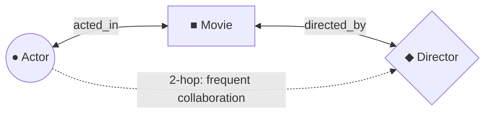

# 🎬 Tollywood Knowledge Graph

Welcome to the **Tollywood Knowledge Graph**! This project maps the rich, interconnected ecosystem of Telugu cinema into a tripartite network connecting **Movies**, **Actors**, and **Directors**.

By representing Tollywood as a continuous graph, you can explore creative lineages, discover frequent director-actor collaborations, find shortest connection paths, and interactively browse decades of Telugu cinematic history.

---

## 🧠 Graph Architecture: Tripartite Constellation

The knowledge graph is modeled as a heterogeneous, multi-relational network:



### Visual Schema & 3-Column Timeline Layout
The interactive web visualizer organizes the industry into a balanced tripartite constellation:

| Column | Entity Type | Geometric Shape | Position ($X$-axis) | Vertical Alignment ($Y$-axis) |
| :--- | :--- | :--- | :--- | :--- |
| **Left** | **Actors** | Circle (`●`) | $X = -60,000$ | Ordered strictly by **Date of Birth / Era** |
| **Center** | **Movies** | Square (`■`) | $X = 0$ | Ordered by **Release Year** |
| **Right** | **Directors** | Diamond (`◆`) | $X = +60,000$ | Ordered by **Debut Year** |

* All three columns share the same vertical temporal continuum: vintage golden-era pioneers at the top, contemporary modern cinema at the bottom.
* Director nodes are rendered via a custom GPU-accelerated WebGL shader program (`NodeDiamondProgram`).

---

## 🔍 Degrees of Separation Pathfinder (`find_connection.py`)

Find the shortest connection chain between any two Tollywood actors, directors, or movies using breadth-first search (BFS):

```bash
# Find connection between any two stars:
python find_connection.py "Prabhas" "Chiranjeevi"

# Find connection between a director and an actor:
python find_connection.py "S. S. Rajamouli" "Mahesh Babu"

# Find the "Brahmanandam Number" for an actor:
python find_connection.py "Vijay Deverakonda" --brahmi
```

### Example Output:
```
🔍 Connecting [Prabhas] (actor) to [Chiranjeevi] (actor)...

🎉 Connection found! Total graph hops: 4
============================================================
  1. [Prabhas]
     └─► acted in "The Rajasaab" (2026) as 'Raju / Rajasaab'
  2. [The Rajasaab (2026)]
     └─► starred Zarina Wahab
  3. [Zarina Wahab]
     └─► acted in "Mana ShankaraVaraPrasad Garu" (2026)
  4. [Mana ShankaraVaraPrasad Garu (2026)]
     └─► starred Chiranjeevi
     └─► [Chiranjeevi]
============================================================
✨ Prabhas and Chiranjeevi are separated by 4 connection steps.
```

---

## 🎞️ Dataset Statistics

* **Movies:** 3,927 Telugu feature films spanning from 1930s to 2026+.
* **Directors:** 1,680 unique Tollywood filmmakers (enriched with TMDB profile images, debut years, and frequent collaborators).
* **Actors:** Comprehensive cast network with co-star edge weights and collaboration clusters.
* **Data Sources:** Sourced and enriched via [The Movie Database (TMDB) API](https://www.themoviedb.org/).

---

## 💻 Tech Stack

### 🐍 Data Pipeline & Analytics (Python)
* **Python 3.11+**
* **NetworkX & SciPy:** Graph traversal, BFS shortest-path, and Laplacian Fiedler eigenvector collaboration axis.
* **JSON Caching:** Local disk-backed TMDB API response cache.

### ⚛️ Frontend Web App (React + Sigma.js)
* **React 19 + Vite:** Fast, modern single-page web app.
* **Sigma.js v3 & Graphology:** WebGL canvas rendering for tens of thousands of nodes and edges at 60 FPS.
* **Custom WebGL Shaders:** `NodeDiamondProgram` for hardware-accelerated diamond rendering.
* **Interactive Controls:**
  * **Graph Legend:** In-canvas legend showing entity counts with click-to-pan camera actions.
  * **Interactive Search Bar:** Real-time search with dedicated Actor / Director / Movie category filters.
  * **Detailed Inspector Sidebar:** Shows posters, filmographies, ratings, and one-click camera focusing.
  * **Cast Web Mode:** Toggleable 2-hop cast visualization for directors.
  * **DOB Timeline Scale:** Vertical scrubber for jumping across decades.

---

## 🚀 Getting Started

### 1. Web Application
```bash
# Navigate to web app
cd app

# Install dependencies
npm install

# Start local development server
npm run dev
```
Open `http://localhost:5173` in your browser.

### 2. Running Pathfinder CLI
```bash
# From repository root
python find_connection.py "Allu Arjun" "Brahmanandam"
```

---

## 📄 License
This project is open-source under the MIT License.
Data provided by TMDB (not endorsed or certified by TMDB).
